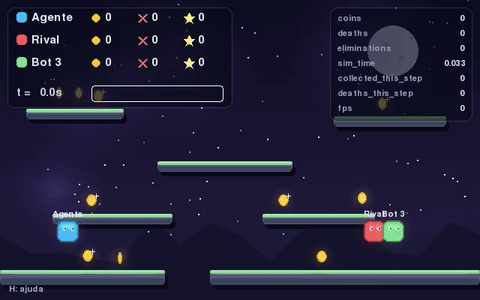

# RL Arena — plataforma 2D mínima para DQN

Projeto didático para estudar Reinforcement Learning na prática: um agente DQN (PyTorch + Gymnasium + NumPy + Pygame) treina num mapa 2D fixo para coletar moedas e empurrar um adversário de política simples. Há quatro implementações prontas — um DQN enxuto, um Double DQN com replay priorizado e rede dueling, e os algoritmos on-policy PPO e A2C — e este guia leva você do zero até plugar o seu próprio modelo e o seu próprio algoritmo de RL.

## Demonstração

[](demo.mp4)

O gif mostra os primeiros 10 segundos; o vídeo completo está em [`demo.mp4`](demo.mp4) (clique para abrir o player).

## Guia de uso

Ambiente: Linux. Pré-requisitos: Python 3.10 ou mais novo e familiaridade básica com terminal.

### 1. Instalar

```bash
python -m venv venv
source venv/bin/activate
pip install -r requirements.txt
```

### 2. Treinar do zero

```bash
python train.py --episodes 300                       # alg_dqn (padrão)
python train.py --episodes 300 --alg doubledqn_per_dueling
python train.py --episodes 300 --alg ppo
python train.py --episodes 300 --alg a2c
python train.py --max-hours 3                        # treina por 3 h de parede
```

Treina sem abrir janela (padrão). `--alg` escolhe o pacote `alg_<nome>` na raiz do projeto. Ao final, os pesos ficam em `checkpoints/latest.pt` e `checkpoints/best.pt`; as métricas por episódio, em `logs/training.csv`.

Dica: se o terminal for inundado por avisos do NNPACK, rode com `TORCH_CPP_LOG_LEVEL=ERROR python train.py ...`.

### 3. Assistir o treino

```bash
python train.py --episodes 100 --render
```

Abre a janela do Pygame mostrando o agente aprendendo (fechar a janela encerra o processo).

### 4. Avaliar sem atualizar pesos

```bash
python evaluate.py --checkpoint checkpoints/best.pt --episodes 20
```

Executa a política gulosa (sem explorar nem atualizar pesos) e grava `logs/evaluation.csv`. Com `--render`, mostra a janela.

### 5. Jogar e assistir

```bash
python play.py --checkpoint checkpoints/best.pt --render
```

Sem `--render`, executa os episódios sem abrir janela.

Também dá para dispensar o checkpoint e rodar políticas baseline, por exemplo `coins` contra `coins` (ambos perseguem moedas, sem empurrões):

```bash
python play.py --player coins --opponent coins --render
```

Para jogar no teclado contra um adversário não humano (a janela abre automaticamente):

```bash
python play.py --player human --opponent coins
```

| Tecla | Ação |
|---|---|
| ← → ou A D | Andar |
| Espaço / ↑ / W | Pular (diagonal se estiver andando) |
| Q | Empurrar para a esquerda (força máxima) |
| E | Empurrar para a direita (força máxima) |

### 6. Experimentar

- Algoritmo: `--alg dqn` (padrão), `doubledqn_per_dueling`, `ppo` ou `a2c` — veja [Algoritmos](#algoritmos).
- Adversário: `--opponent random`, `coins` ou `rule` (o padrão `auto` é um currículo — veja [Adversários](#adversários)).
- Semente: `--seed N` (treinos com a mesma semente são idênticos).
- Mundo: física, recompensas, duração do episódio e contagens ficam em `arena/config.py`.
- Vetorização: `--envs N` só vale para algoritmos off-policy (DQN/Double DQN); PPO e A2C exigem `--envs 1`.

### 7. Seu próprio modelo e seu próprio algoritmo de RL

Cada algoritmo é um diretório `alg_<nome>` autocontido, com o modelo, o replay e o loop de aprendizado:

```text
alg_dqn/                          # --alg dqn (padrão)
├── model.py                      # QNetwork: CNN -> 6 Q-valores diretos
├── replay_buffer.py              # amostragem uniforme
└── agent.py                      # DQNAgent + Agent = DQNAgent + td_target

alg_doubledqn_per_dueling/        # --alg doubledqn_per_dueling
├── model.py                      # DuelingQNetwork: Q = V + A - média(A)
├── replay_buffer.py              # PER rank-based (prioridade = |erro de TD|)
└── agent.py                      # DoubleDQNPerDuelingAgent + double_td_target

alg_ppo/                          # --alg ppo
├── model.py                      # ActorCriticNetwork: logits + V(s)
├── rollout_buffer.py             # transições on-policy + fronteira de episódio
└── agent.py                      # PPOAgent + compute_gae

alg_a2c/                          # --alg a2c
├── model.py                      # ActorCriticNetwork: logits + V(s)
├── rollout_buffer.py             # transições on-policy + fronteira de episódio
└── agent.py                      # A2CAgent + n_step_returns
```

O contrato mínimo de um pacote é um `agent.py` expondo `Agent` (a classe usada por `train.py`, `evaluate.py` e `play.py`) e uma instância com `algorithm` (nome gravado no checkpoint), `arch_version`, `obs_shape`, `n_actions`, `online`, `target`, `optimizer`, `buffer`, `steps`, `epsilon`, além dos métodos `act`, `act_batch`, `learn`, `q_stats` e `head_weights`. O `alg_registry.py` descobre os diretórios, importa o pacote e centraliza o checkpoint pesos-only e o adaptador `CheckpointPolicy`.

Algoritmos on-policy podem declarar `on_policy = True` e implementar dois ganchos opcionais: `end_episode(info)`, chamado ao fim de cada episódio (marca a fronteira no rollout e, no A2C, consome o rabo do buffer), e `finish_training()`, chamado antes do checkpoint final (o PPO consome o rollout parcial). Nesses algoritmos `target` é um alias de `online`, porque não existe rede-alvo; o campo continua no checkpoint para manter o formato comum. `--envs` maior que 1 é rejeitado para eles: o loop vetorizado não mapeia a fronteira de episódio necessária ao rollout.

Para colocar o seu no lugar:

- **Só a rede**: copie/edite o `model.py` de um algoritmo mantendo a entrada da CNN e a saída com `n_actions` valores. O agente, o treino, os checkpoints e a retomada continuam funcionando.
- **O algoritmo inteiro**: crie `alg_meu/agent.py` com a classe `Agent` no contrato acima. `--alg meu` passa a funcionar automaticamente, sem tocar em `train.py`; `evaluate.py` e `play.py` reconhecem o algoritmo pelo checkpoint.
- **Uma política nova (ex.: para o adversário)**: implemente `act(ctx: PolicyContext)` e registre o nome em `make_policy()`, em `agents/baseline.py`.

### 8. Verificar

```bash
python -m pytest -q
```

São 116 testes (~10–30 s, dependendo da carga da máquina). Rode depois de instalar e depois de cada mudança sua para confirmar que nada quebrou.

## Referência

### Ações

Seis ações, com uma única intensidade de pulo e uma única de empurrão por direção (a maior da versão anterior):

| Índice | Ação |
|---:|---|
| 0 | Não fazer nada |
| 1 | Andar para a esquerda |
| 2 | Andar para a direita |
| 3 | Pular verticalmente (força máxima) |
| 4 | Empurrar adversário para a esquerda (força máxima) |
| 5 | Empurrar adversário para a direita (força máxima) |

Os códigos ficam em `arena/actions.py` (`N_ACTIONS = 6`), usados pelo engine, ambiente, políticas e pela rede. Uma ação de empurrão não move o personagem no mesmo passo.

Ficar parado tem um custo pequeno: escolher `STOP` desconta `stop_penalty = -0.1` **uma vez por step do agente** (não por substep de `frame_skip`). Empurrar (`PUSH_LEFT`/`PUSH_RIGHT`) sem oponente vivo em contato no início do step também desconta `push_miss_penalty = -0.1`, uma vez por step; o ambiente usa a mesma regra `touching` do engine. Ações que não se encaixam nesses casos não pagam essas penalidades. Os valores ficam em `ArenaConfig`.

### Algoritmos

Os algoritmos off-policy (`dqn` e `doubledqn_per_dueling`) usam a mesma observação, o mesmo alvo fixo `C = 10` (sincroniza a rede-alvo a cada 10 `learn()` bem-sucedidos) e o mesmo contrato, para que a comparação isole as técnicas. PPO e A2C usam a mesma observação e o mesmo formato de checkpoint, mas são on-policy:

- **`dqn`** (padrão): o DQN enxuto do artigo — Q direto por ação, replay uniforme (toda transição com a mesma chance) e alvo `r + γ·max Q(s', ·)`.
- **`doubledqn_per_dueling`**: três mudanças sobre o `dqn`:
  - **Double DQN**: a rede online escolhe a ação do próximo estado e a target avalia o valor, reduzindo a superestimação;
  - **PER**: a amostragem do replay favorece transições com erro de TD alto (prioridade `|erro| + 1e-6`, rank-based);
  - **Dueling**: a rede separa `V(s)` de `A(s, a)` e devolve `Q = V + A − média(A)`.
- **`ppo`**: on-policy, com ator categórico e crítico compartilhando a CNN. O rollout tem 1024 transições; o GAE(λ=0.95) usa a marca de fim de episódio para não misturar episódios, mas faz bootstrap no truncamento por tempo. O update tem 4 épocas de minibatches de 64, clip de razão 0.2, perda de valor 0.5, bônus de entropia 0.01 e grad clip 10. O rollout parcial é consumido em `finish_training()`.
- **`a2c`**: on-policy, com a mesma rede actor-critic, mas retornos n-step (`n_steps = batch_size`, 64 no protocolo) e um único passo de otimização por rollout. Quando o episódio termina antes de completar o rollout, `end_episode()` consome o rabo; o retorno usa bootstrap no truncamento e não atravessa a fronteira do episódio. Usa as mesmas perdas de valor e entropia do PPO.

```bash
python train.py --episodes 300 --alg dqn
python train.py --episodes 300 --alg doubledqn_per_dueling
python train.py --episodes 300 --alg ppo
python train.py --episodes 300 --alg a2c
```

PPO e A2C são on-policy e exigem `--envs 1`; a política é estocástica no treino e gulosa na avaliação (`evaluate.py`/`play.py` chamam `act(..., greedy=True)`).

`evaluate.py` e `play.py` não precisam de `--alg`: o checkpoint grava o algoritmo e esses scripts carregam o pacote certo.

### Adversários

- `auto` (padrão): currículo — 50 episódios contra `random`, depois alterna `coins`/`rule` e, por fim, joga contra o melhor checkpoint, com 10% dos episódios contra outra política. As fases usam contagens absolutas, então retomar continua o currículo de onde parou.
- `random`: sorteia entre as 4 primeiras ações (não empurra, preservando o comportamento histórico).
- `rule`: aproxima do jogador e às vezes empurra (ações 4/5).
- `coins`: persegue a moeda visível.

As políticas ficam em `agents/baseline.py`.

### Checkpoints e retomada

```bash
python train.py --episodes 300 --resume checkpoints/latest.pt
python train.py --episodes 300 --checkpoint-dir /caminho/para/run1 --resume latest.pt
```

`--episodes` indica episódios **adicionais** ao retomar. O checkpoint é pesos-only: guarda as redes (online e alvo), o otimizador, os passos de treino, o epsilon, o número de episódios consumidos, a config do ambiente e os metadados `algorithm`/`arch_version`/`n_actions`/`obs_shape` — retomar continua a numeração de episódios e o treino de onde parou. Replay buffer, rollout on-policy e RNGs **não** são persistidos, então a retomada não é mais reproduzível bit a bit. Em PPO/A2C o campo `target` repete os pesos da online (não há rede-alvo) e `epsilon` fica em 0; o restante do formato é idêntico.

O algoritmo, a versão de arquitetura, o número de ações e o formato da observação são validados **antes** de copiar qualquer peso: retomar com `--alg` diferente, com `frame_stack` diferente ou com um checkpoint antigo (formato `cnn-dqn-*`, 12 ações) falha com mensagem clara, sem deixar o agente com pesos parcialmente sobrescritos.

### Estatísticas e TensorBoard

```bash
python train.py --episodes 300 --stats
```

grava `logs/stats.csv` por episódio: recompensa, perda (média/mín/máx), norma do gradiente antes do clip, valores do crítico (ou Q-values, nos algoritmos de valor), epsilon e tamanho do buffer. Em PPO/A2C o buffer é o rollout e volta a zero a cada update; episódios sem update podem ficar com perda vazia.

```bash
python train.py --episodes 300 --tensorboard
tensorboard --logdir logs/runs
```

mostra as mesmas curvas, histogramas dos pesos da CNN e a observação como imagem. Cada experimento escreve em `logs/runs/<alg>_configs_<opponent>_fs<stack>_fk<skip>_lr<lr>_b<batch>_seed<seed>`; o nome inclui algoritmo e configurações para distinguir os runs no TensorBoard. Use `--run-name NOME` para escolher um nome explícito.

Para treinos por tempo de parede, `--max-hours N` encerra de forma limpa após N horas: o episódio corrente termina, o `latest.pt` é salvo com o número real de episódios concluídos e, em PPO/A2C, o rollout parcial é consumido por `finish_training()` antes do checkpoint final.

### Comparações controladas

`scripts/compare_onpolicy.sh` repete o protocolo da comparação DQN/Double DQN para PPO e A2C: seed 7, 100 episódios, adversário `rule`, `frame_stack=4`, `frame_skip=3`, `batch_size=64`, TensorBoard e avaliação gulosa com 20 episódios (seed 1000) nos snapshots `budget/ep050.pt`, `budget/ep100.pt` e `best.pt`. O script grava treino, avaliações e logs em `logs/compare` e deixa cada run do TensorBoard com o nome `logs/runs/<alg>_configs_rule_fs4_fk3_lr<lr>_b64_seed7`; ele se recusa a sobrescrever checkpoints ou runs existentes.

```bash
PYTHON=venv/bin/python bash scripts/compare_onpolicy.sh
```

`scripts/train_long.sh` usa o mesmo protocolo, mas com orçamento de parede: cada algoritmo treina `HOURS` horas (padrão 3) com `--max-hours` e é avaliado em `best.pt` e `latest.pt` (20 episódios, seed 1000). Grava `checkpoints/long3h/<tag>` e `logs/long3h/{training,evaluation}-*.csv`; os runs do TensorBoard levam o sufixo `_3h`. Assim como o runner de comparação, recusa sobrescrever diretórios existentes.

```bash
PYTHON=venv/bin/python bash scripts/train_long.sh          # 3 h por algoritmo
HOURS=1 PYTHON=venv/bin/python bash scripts/train_long.sh  # orçamento menor
```

`scripts/summarize_all.py logs/compare` lê os CSVs dos quatro algoritmos e escreve `summary-all.txt`, `training_summary_all.csv`, `evaluation_summary_all.csv` e `comparacao-all.md`, com deltas pareados contra o DQN e ranking pela avaliação. Para o protocolo por tempo de parede, use `scripts/summarize_all.py logs/long3h --hours 3`, que descreve o orçamento e inclui o checkpoint `final` (`latest.pt`) na avaliação. A avaliação usa uma seed e 20 episódios; diferenças pequenas estão dentro do ruído.

### Skins

```bash
python play.py --player human --opponent coins --skin neon
```

Cada skin é um arquivo `arena/renderer_<skin>.py`; as opções de `--skin` são descobertas automaticamente — criar `arena/renderer_dinosaur.py` já habilita `--skin dinosaur`.

### Gravação de vídeo

```bash
python play.py --player coins --opponent coins --record demonstracao.mp4
```

30 fps na resolução da arena, H.264 (`yuv420p`, crf 23, `faststart`) — compatível com WhatsApp e players comuns (~1–2 MB por episódio). Requer `imageio` e `imageio-ffmpeg`. Para gravar sem janela: `SDL_VIDEODRIVER=dummy python play.py ...`.

### Observações e limitações da versão didática

- O cenário e a configuração inicial são fixos.
- O episódio termina pelo limite de tempo (truncamento), nunca apenas por morte. Ao morrer, o personagem perde 10 moedas (saldo mínimo zero), fica inativo por 5 s simulados e reaparece sobre uma plataforma aleatória.
- A observação é uma grade semântica `(5, H, W)`; velocidades e temporizadores não estão codificados, então a observação não é totalmente Markoviana — simplificação deliberada para a primeira experiência com CNN.

### Ideias para simplificar ainda mais o treino

Mudanças de ambiente que costumam acelerar o aprendizado (nenhuma está aplicada por padrão):

- **Terminar o episódio na morte**, em vez de só truncar aos 45 s: encurta o retorno e dá um sinal de fim mais claro (a morte hoje só custa 5 s e 10 moedas).
- **Episódios mais curtos** (15–20 s): mais episódios por hora e menos passos em estados fáceis; combine com o término na morte.
- **Adversário fixo** (`--opponent coins` ou `rule`) durante a comparação de algoritmos: menos não-estacionariedade que o currículo `auto`; use o `auto` depois.
- **Estado compacto** (posições e velocidades dos personagens, moedas e plataformas) com um MLP no lugar da CNN: resolve a não-Markovianidade e treina muito mais rápido; mantenha `alg_dqn` como variante com imagem.
- **Rede menor** (menos filtros, cabeça 128 → 64) e `--frame-stack 4 --frame-skip 3`: menos parâmetros e mais passos de simulação por segundo.
- **Recompensa mais densa** (ex.: pequeno bônus por se aproximar da moeda): acelera o aprendizado inicial, mas pode enviesar a política — meça com e sem.

### Estrutura

```text
rl-arena/
├── arena/                    # configuração, motor, ambiente, ações e renderizadores
├── agents/                   # políticas baseline usadas como adversário
├── alg_dqn/                  # DQN enxuto: QNetwork, replay uniforme, DQNAgent
├── alg_doubledqn_per_dueling/  # Double DQN + PER + dueling
├── alg_ppo/                  # PPO: actor-critic, rollout com GAE
├── alg_a2c/                  # A2C: actor-critic, retornos n-step
├── alg_registry.py           # descoberta dos alg_*, checkpoint e CheckpointPolicy
├── scripts/                  # comparações controladas e sumarizador
├── tests/
├── train.py
├── evaluate.py
├── play.py
├── requirements.txt
└── README.md
```
