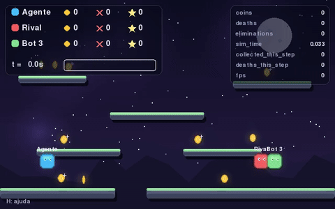

# RL Arena — plataforma 2D mínima para aprendizagem por reforço (multi-agentes)

> **Localização:** este jogo vive em `arenas/seek_coin/`. Os comandos abaixo
> assumem esse diretório (`cd arenas/seek_coin`); da raiz, use o CLI
> unificado: `python train.py --arena seek_coin ...`. Os algoritmos agora são
> compartilhados em `arenas/algs/`.

Projeto didático para estudar Reinforcement Learning na prática: um agente DQN (PyTorch + Gymnasium + NumPy + Pygame) treina num mapa 2D fixo para coletar moedas e empurrar um adversário de política simples. Há quatro implementações prontas — um DQN enxuto, um Double DQN com replay priorizado e rede dueling, e os algoritmos on-policy PPO e A2C — e este guia leva você do zero até plugar o seu próprio modelo e o seu próprio algoritmo de RL.

## Demonstração

[](demo.mp4)

O gif mostra os primeiros 10 segundos; o vídeo completo está em [`demo.mp4`](demo.mp4) (clique para abrir o player).

## Guia de uso

Ambiente: Linux. Pré-requisitos: Python 3.10 ou mais novo e familiaridade básica com terminal.

### 1. Instalar

```bash
python -m venv venv
source venv/bin/activate
pip install -r requirements.txt
```

### 2. Treinar do zero

```bash
python train.py --episodes 300                       # alg_dqn (padrão)
python train.py --episodes 300 --alg doubledqn_per_dueling
python train.py --episodes 300 --alg ppo
python train.py --episodes 300 --alg a2c
python train.py --max-hours 3                        # treina por 3 h de parede
python train.py --episodes 300 --tensorboard --eval-every 10  # curvas + avaliação gulosa periódica
```

Treina sem abrir janela (padrão). `--alg` escolhe o pacote `alg_<nome>` em `arenas/algs/`. Ao final, os pesos ficam em `checkpoints/latest.pt` e `checkpoints/best.pt`; as métricas por episódio, em `logs/training.csv`.

Dica: se o terminal for inundado por avisos do NNPACK, rode com `TORCH_CPP_LOG_LEVEL=ERROR python train.py ...`.

**Multiagente (IPPO, MAPPO e HAPPO).** Use `--alg ippo`, `--alg mappo` ou
`--alg happo` para treinar todos os agentes ao mesmo tempo. O IPPO tem um crítico
local por agente; o MAPPO usa um **crítico centralizado** (CTDE), que vê as
features de todos os agentes durante o treino, embora a política continue
descentralizada na execução. O HAPPO dá um ator independente a cada agente e faz
o update em sequência, corrigindo a razão pelo produto das razões já atualizadas.
Em `--scenario all-vs-all` cada agente é um time; em `--scenario teams --teams K`
os agentes são divididos em K times de mesmo tamanho. Em times, a recompensa de
cada membro é a média das recompensas do time. Em
`--scenario collectors-vs-pushers --teams K` cada time é misto: metade só coleta
e metade só empurra (time precisa ser par). Coletores têm `PUSH_*` mascarados e
não coletam pela política; empurradores não coletam moedas do mapa e só ganham
saldo transferindo moedas no empurrão, calibrado para meia arena com recarga de
2 s.

```bash
python train.py --alg ippo --agents 4 --scenario all-vs-all --checkpoint-dir checkpoints/all4
python train.py --alg mappo --agents 4 --scenario teams --teams 2 --checkpoint-dir checkpoints/mappo_teams4
python train.py --alg happo --agents 4 --scenario collectors-vs-pushers --teams 2 --checkpoint-dir checkpoints/happo_roles
python evaluate.py --checkpoint checkpoints/teams4/best.pt --episodes 10
python play.py --checkpoint checkpoints/teams4/best.pt --render   # modo espectador
python play.py --checkpoint checkpoints/teams4/best.pt --player human --human-agent 0  # você + agente no time
python scripts/duel_multiagent.py \
  --mappo-checkpoint checkpoints/mappo_teams4_3h/best.pt \
  --ippo-checkpoint checkpoints/ippo_teams4_3h/best.pt \
  --record duelo.mp4   # MAPPO × IPPO, um checkpoint por time
```

Com `--player human` num checkpoint multiagente, o agente `--human-agent N` (padrão 0) é controlado pelo teclado; o colega de time e os adversários usam o checkpoint. É preciso um cenário `teams` em que esse agente tenha colega. No modo humano o render desenha **cada substep** de física (30 fps), enquanto as decisões continuam uma vez por `frame_skip` substeps. O padrão de `--agents` é 4 com um algoritmo multiagente (1 nos demais algoritmos).
Na primeira versão, multiagente não combina com `--envs`, `--overlap` nem
`--opponent` baseline.

### 3. Assistir o treino

```bash
python train.py --episodes 100 --render
```

Abre a janela do Pygame mostrando o agente aprendendo (fechar a janela encerra o processo).

### 4. Avaliar sem atualizar pesos

```bash
python evaluate.py --checkpoint checkpoints/best.pt --episodes 20
```

Executa a política gulosa (sem explorar nem atualizar pesos) e grava `logs/evaluation.csv`. Com `--render`, mostra a janela.

### 5. Jogar e assistir

```bash
python play.py --checkpoint checkpoints/best.pt --render
```

Sem `--render`, executa os episódios sem abrir janela.

Também dá para dispensar o checkpoint e rodar políticas baseline, por exemplo `coins` contra `coins` (ambos perseguem moedas, sem empurrões):

```bash
python play.py --player coins --opponent coins --render
```

Para jogar no teclado contra um adversário não humano (a janela abre automaticamente):

```bash
python play.py --player human --opponent coins
```

O adversário também pode ser humano ou outro checkpoint:

```bash
python play.py --checkpoint checkpoints/best.pt --opponent human --render
python play.py --checkpoint checkpoints/best.pt --opponent checkpoints/long3h/ppo/latest.pt --render
python play.py --player human --opponent checkpoints/long3h/ppo/latest.pt --render
```

Com `--opponent human` a janela também abre sozinha e o adversário usa o mesmo teclado do jogador (`--player human` e `--opponent human` juntos são recusados). Ao colocar dois checkpoints no mesmo ambiente, o `play.py` exige o mesmo `frame_stack`/`frame_skip`; se forem diferentes, ele explica o conflito antes de iniciar.

| Tecla | Ação |
|---|---|
| ← → ou A D | Andar |
| Espaço / ↑ / W | Pular (diagonal se estiver andando) |
| Q | Empurrar para a esquerda (força máxima) |
| E | Empurrar para a direita (força máxima) |

### 6. Experimentar

- Algoritmo: `--alg dqn` (padrão), `doubledqn_per_dueling`, `mka`, `ppo`, `eppo`, `ppo_aes`, `gtr`, `a2c`, `sac_discrete`, `ippo`, `mappo` ou `happo` — veja [Algoritmos](#algoritmos) e `docs/algoritmos.md`.
- Adversário: `--opponent random`, `coins` ou `rule` (o padrão `auto` é um currículo — veja [Adversários](#adversários)).
- Semente: `--seed N` (treinos com a mesma semente são idênticos).
- Duração: `--episode-seconds N` (padrão 90; o valor fica no checkpoint e é reaplicado no `evaluate.py`/`play.py`).
- Níveis: `--level 2` adiciona areia/gelo; `--level 3` adiciona botões de ativação/cancelamento e uma super moeda de alto valor. No nível 3, o botão de ativação fica no chão da esquerda, o de cancelamento na plataforma central e a super moeda no chão da direita; os tempos/valores ficam em `super_coin_seconds`, `super_coin_cooldown`, `super_coin_reward` e `super_coin_coins` no `ArenaConfig`. O renderer default desenha os botões e a super moeda; as skins alternativas podem não exibir esses elementos.
- Visão local (nível 4): `--level 4` usa o mapa do nível 3, mas com a **mecânica de botões/super moeda desligada por padrão** (a observação volta aos 5 canais base; `--super-coin` reativa os botões e os 3 canais extras). A observação é um recorte `view_size × view_size` (ímpar; padrão 9 células ≈ 180 px) centrado no agente; `--view-size 7` estreita a janela. Fora dos limites do mapa o recorte é preenchido com zeros e tudo o que está fora da janela simplesmente não aparece. Os níveis 0–3 continuam entregando o mapa inteiro. No multiagente cada agente recebe o próprio recorte. O renderer default escurece a área fora da janela para mostrar o campo de visão; o `GpuArenaVecEnv` recusa o nível 4 (use o caminho em CPU). A observação passa a ser parcialmente observável: o frame stack continua disponível, mas memória recorrente (RNN/Transformer) fica como evolução futura.
- Mundo procedural (nível 5): `--level 5` gera chunks determinísticos de 480 px (seed + índice do chunk) com chão e buracos, plataformas elevadas/móveis, moedas e areia/gelo. O mundo rola quando o agente passa de ~55% da largura; o que fica para trás é descartado, então a memória e o custo por passo ficam limitados ao que está na tela. Usa a visão local do nível 4 e o canal extra `hole`; `info` traz `distance` e `chunks`. Cair num buraco custa morte/respawn na plataforma de chão mais próxima. O nível 5 é single-agent por enquanto (o multiagente recusa esse nível).
- Mundo: física, recompensas, duração do episódio e contagens ficam em `arena/config.py`.
- Vetorização: `--envs N` coleta em N workers paralelos e age em lote; vale para todos os algoritmos (exige adversário fixo e desliga render/telemetria por episódio).
- Sobreposição: `--overlap` (só PPO/A2C) coleta o próximo rollout nos workers de CPU enquanto a GPU atualiza o anterior — ~30% mais episódios/hora no protocolo de 8 workers. A política fica defasada em um update; o PPO guarda o log-prob da coleta para o ratio continuar correto.

### 7. Seu próprio modelo e seu próprio algoritmo de RL

Cada algoritmo é um diretório `arenas/algs/alg_<nome>` autocontido, com o modelo, o replay e o loop de aprendizado (a lista completa e o contrato estão em `arenas/algs/README.md` e `docs/algoritmos.md`):

```text
arenas/algs/
├── alg_registry.py               # descoberta, checkpoint e CheckpointPolicy
├── alg_dqn/                      # --alg dqn (padrão)
│   ├── model.py                  # QNetwork: CNN -> 6 Q-valores diretos
│   ├── replay_buffer.py          # amostragem uniforme
│   └── agent.py                  # DQNAgent + Agent = DQNAgent + td_target
├── alg_doubledqn_per_dueling/    # --alg doubledqn_per_dueling
│   ├── model.py                  # DuelingQNetwork: Q = V + A - média(A)
│   ├── replay_buffer.py          # PER rank^-α (α=0,6) + pesos de importância
│   └── agent.py                  # DoubleDQNPerDuelingAgent + double_td_target
├── alg_ppo/                      # --alg ppo
│   ├── model.py                  # ActorCriticNetwork: logits + V(s)
│   ├── rollout_buffer.py         # transições on-policy + fronteira de episódio
│   └── agent.py                  # PPOAgent + compute_gae
└── alg_a2c/                      # --alg a2c
    ├── model.py                  # ActorCriticNetwork: logits + V(s)
    ├── rollout_buffer.py         # transições on-policy + fronteira de episódio
    └── agent.py                  # A2CAgent + n_step_returns
```

O contrato mínimo de um pacote é um `agent.py` expondo `Agent` (a classe usada por `train.py`, `evaluate.py` e `play.py`) e uma instância com `algorithm` (nome gravado no checkpoint), `arch_version`, `obs_shape`, `n_actions`, `online`, `target`, `optimizer`, `buffer`, `steps`, `epsilon`, além dos métodos `act`, `act_batch`, `learn`, `q_stats` e `head_weights`. O `arenas/algs/alg_registry.py` descobre os diretórios, importa o pacote e centraliza o checkpoint pesos-only e o adaptador `CheckpointPolicy`.

Algoritmos on-policy podem declarar `on_policy = True` e implementar dois ganchos opcionais: `end_episode(info)`, chamado ao fim de cada episódio (marca a fronteira no rollout e, no A2C, consome o rabo do buffer), e `finish_training()`, chamado antes do checkpoint final (o PPO consome o rollout parcial). Nesses algoritmos `target` é um alias de `online`, porque não existe rede-alvo; o campo continua no checkpoint para manter o formato comum. `--envs` maior que 1 também funciona para eles: a coleta monta o rollout em blocos por worker e fecha cada bloco como fronteira de episódio, então GAE/n-step nunca atravessa trajetórias de workers diferentes.

Para colocar o seu no lugar:

- **Só a rede**: copie/edite o `model.py` de um algoritmo mantendo a entrada da CNN e a saída com `n_actions` valores. O agente, o treino, os checkpoints e a retomada continuam funcionando.
- **O algoritmo inteiro**: crie `arenas/algs/alg_meu/agent.py` com a classe `Agent` no contrato acima. `--alg meu` passa a funcionar automaticamente, sem tocar em `train.py`; `evaluate.py` e `play.py` reconhecem o algoritmo pelo checkpoint.
- **Uma política nova (ex.: para o adversário)**: implemente `act(ctx: PolicyContext)` e registre o nome em `make_policy()`, em `agents/baseline.py`.

### 8. Verificar

```bash
python -m pytest -q
```

São 354 testes (~10–30 s, dependendo da carga da máquina). Rode depois de instalar e depois de cada mudança sua para confirmar que nada quebrou.

## Referência

### Ações

Seis ações, com uma única intensidade de pulo e uma única de empurrão por direção (a maior da versão anterior):

| Índice | Ação |
|---:|---|
| 0 | Não fazer nada |
| 1 | Andar para a esquerda |
| 2 | Andar para a direita |
| 3 | Pular verticalmente (força máxima) |
| 4 | Empurrar adversário para a esquerda (força máxima) |
| 5 | Empurrar adversário para a direita (força máxima) |

Os códigos ficam em `arena/actions.py` (`N_ACTIONS = 6`), usados pelo engine, ambiente, políticas e pela rede. Uma ação de empurrão não move o personagem no mesmo passo.

Ficar parado tem um custo pequeno: escolher `STOP` desconta `stop_penalty = -0.1` **uma vez por step do agente** (não por substep de `frame_skip`). Empurrar (`PUSH_LEFT`/`PUSH_RIGHT`) sem oponente vivo em contato no início do step também desconta `push_miss_penalty = -0.1`, uma vez por step; o ambiente usa a mesma regra `touching` do engine. Ações que não se encaixam nesses casos não pagam essas penalidades. Cada empurrão que encontra alvo também transfere até `push_coin_transfer = 5` moedas do empurrado para quem empurrou (o saldo do alvo nunca fica negativo), e a transferência entra na recompensa com peso `coin_reward`: positiva para quem empurra, negativa para o alvo. `push_coin_transfer = 0` desliga o efeito. O peso da recompensa é separado da mecânica: `cfg.push_coin_reward` (CLI `--push-coin-reward`, default 1.0) multiplica as moedas transferidas na recompensa sem mudar quantas moedas passam no jogo — útil para o empurrão não dominar a coleta de +1. Os valores ficam em `ArenaConfig`. `--pbrs-coef` ativa o reward shaping por potencial sobre a **diferença** de moedas: `r += coef * (pbrs_gamma * Phi(s') - Phi(s))`, com `Phi = moedas do meu time - moedas dos inimigos` e `pbrs_gamma = 0.99` (deve casar com o `gamma` do agente); preserva a política ótima e dá sinal denso para o objetivo final. No treino multiagente, `--save-every-minutes N` grava snapshots em `<checkpoint-dir>/timed/` e `--video-every-minutes N` grava um episódio guloso por MP4 em `<checkpoint-dir>/videos/`, ambos a cada N minutos de parede.

### Algoritmos

Os algoritmos off-policy (`dqn`, `doubledqn_per_dueling` e `mka`) usam a mesma observação, o mesmo contrato e um alvo fixo sincronizado a cada `C = 1000` `learn()` bem-sucedidos (a busca de hiperparâmetros mostrou que `C = 10` é agressivo demais para os dois). PPO, EPPO, PPO-AES, GTR e A2C usam a mesma observação e o mesmo formato de checkpoint, mas são on-policy:

- **`dqn`** (padrão): o DQN enxuto do artigo — Q direto por ação, replay uniforme (toda transição com a mesma chance) e alvo `r + γ·max Q(s', ·)`.
- **`doubledqn_per_dueling`**: três mudanças sobre o `dqn`:
  - **Double DQN**: a rede online escolhe a ação do próximo estado e a target avalia o valor, reduzindo a superestimação;
  - **PER**: a amostragem do replay favorece transições com erro de TD alto (prioridade `|erro| + 1e-6`, sorteio proporcional a `rank^-α` com α=0,6) e o loss pesa cada amostra pelo peso de importância `(N·p)^-β`, com β subindo de 0,4 até 1;
  - **Dueling**: a rede separa `V(s)` de `A(s, a)` e devolve `Q = V + A − média(A)`.
- **`mka`**: variante didática do `dqn` com uma CNN custom (GELU e encoder embutido) no lugar da `QNetwork`. Serve para comparar arquiteturas mantendo o mesmo loop, replay e protocolo; não é um algoritmo novo.
- **`ppo`**: on-policy, com ator categórico e crítico compartilhando a CNN. O rollout tem 1024 transições; o GAE(λ=0.95) usa a marca de fim de episódio para não misturar episódios, mas faz bootstrap no truncamento por tempo. O update tem 4 épocas de minibatches de 64, clip de razão 0.2, perda de valor 0.5, bônus de entropia 0.01 e grad clip 10. O rollout parcial é consumido em `finish_training()`.
- **`eppo`**: PPO com crítico evidencial (distribuição NIG): o crítico estima incerteza, a vantagem vira `A_UCB = E[A] + κ√Var[A]` e a loss do crítico é a NLL evidencial com prior. Exploração guiada por incerteza, mantendo o surrogate recortado do PPO.
- **`ppo_aes`**: PPO com **entropia adaptativa**. O coeficiente de entropia deixa de ser fixo: um scheduler olha o quantil 0,9 do erro de TD, suaviza por EMA e ajusta `λ` dentro de uma faixa. Útil quando o bônus fixo de entropia atrapalha a convergência.
- **`gtr`**: PPO com **região de confiança gaussiana**: soma ao surrogate uma penalidade limitada `½(1−e^{−(r−1)²})` e mistura âncoras (as políticas de início de época) para limitar o passo sem o clip duro.
- **`a2c`**: on-policy, com a mesma rede actor-critic, mas retornos n-step (`n_steps = batch_size`, 64 no protocolo) e um único passo de otimização por rollout. Quando o episódio termina antes de completar o rollout, `end_episode()` consome o rabo; o retorno usa bootstrap no truncamento e não atravessa a fronteira do episódio. Usa as mesmas perdas de valor e entropia do PPO.
- **`ippo`**: on-policy multiagente. Todos os agentes compartilham uma rede actor-critic e têm um buffer de rollout próprio; o update calcula GAE por trajetória e concatena as transições (horizonte `rollout_steps` por agente). O crítico é local: cada agente estima `V(s)` só com a própria observação. A observação é egocêntrica e usa 6 canais: self no 1, inimigos no 2, aliados no 5. Serve para todos-contra-todos e times; nestes últimos a recompensa é a média dos membros. Na primeira versão não aceita `--envs > 1`, `--overlap` nem adversários baseline misturados.
- **`sac_discrete`**: SAC com ator categórico, dois críticos e entropia automática; off-policy e compatível com `Discrete(6)`.
- **`mappo`**: a mesma base do IPPO com **crítico centralizado** (CTDE). O ator compartilhado vê apenas a observação local, mas o crítico recebe as features de todos os agentes no mesmo passo (a grade egocêntrica de cada um já separa self/inimigos/aliados) mais um one-hot que identifica o agente consultado, e é esse estado conjunto que alimenta o GAE. O update agrupa as transições em passos conjuntos: a CNN roda uma vez por agente e serve às duas cabeças. O crítico centralizado reduz a variância do gradiente em troca de depender da observação conjunta na coleta; na execução nada global é consultado, então `evaluate.py`/`play.py` funcionam igual ao IPPO.
- **`happo`**: multiagente **heterogêneo**: cada agente tem o seu ator (e o crítico centralizado vê o estado conjunto), mas o update é sequencial. Ao atualizar o agente `i`, a razão de probabilidade é corrigida pelo produto das razões dos agentes já atualizados, o que preserva o objetivo conjunto sem o "trust region" global do MAPPO. É o algoritmo indicado para papéis diferentes no mesmo time (ex.: `collectors-vs-pushers`).

```bash
python train.py --episodes 300 --alg dqn
python train.py --episodes 300 --alg doubledqn_per_dueling
python train.py --episodes 300 --alg mka                    # variante de arquitetura
python train.py --episodes 300 --alg ppo
python train.py --episodes 300 --alg sac_discrete
python train.py --episodes 300 --alg eppo
python train.py --episodes 300 --alg ppo_aes
python train.py --episodes 300 --alg gtr
python train.py --episodes 300 --alg a2c
python train.py --episodes 300 --alg ppo --envs 8 --opponent rule
python train.py --episodes 300 --alg ppo --envs 8 --overlap --opponent rule
python train.py --episodes 300 --alg ippo --agents 4 --scenario all-vs-all
python train.py --episodes 300 --alg ippo --agents 4 --scenario teams --teams 2
python train.py --episodes 300 --alg mappo --agents 4 --scenario teams --teams 2
python train.py --episodes 300 --alg happo --agents 4 --scenario collectors-vs-pushers --teams 2
```

PPO e A2C são on-policy; a política é estocástica no treino e gulosa na avaliação (`evaluate.py`/`play.py` chamam `act(..., greedy=True)`). Ambos aceitam `--envs N` (com adversário fixo): a coleta age em lote e os retornos são calculados em blocos por worker. Com `--overlap`, uma thread coleta o próximo rollout na CPU (cópia da política) enquanto a thread principal faz o update na GPU; a fila de tamanho 1 limita a defasagem a um rollout. O preço é que o treino deixa de ser bit a bit reprodutível (a versão de pesos usada em cada rollout depende do timing), embora as seeds continuem controlando ambientes e amostragem. Os retornos GAE/n-step são calculados em CPU mesmo com a rede em CUDA — a recorrência escalar na GPU sincroniza por passo (no A2C, o cálculo dos retornos de 64 passos cai de ~41 ms para ~10 ms e o update inteiro de ~45 ms para ~13 ms). Para alimentar melhor a GPU, aumente o minibatch do PPO (`--batch-size 256` reduz o update de 1024 amostras de ~160 ms para ~70 ms); no A2C o `--batch-size` também define o horizonte n-step, então mudá-lo altera o algoritmo.

Nos algoritmos off-policy, a exploração é agendada por **episódio**: `--epsilon-ramp-episodes 150` (padrão) leva ε de 1 até `--epsilon-min 0.1` ao longo de 150 episódios **absolutos**, então retomar continua a rampa de onde parou; `0` desliga a rampa e volta ao decay por passo do agente. `--warmup 1000` adia o primeiro update até o buffer ter 1000 transições. `--learn-every 4` faz um update a cada 4 passos do ambiente (padrão; no modo vetorizado é 1) — menos updates por transição, mais dados por hora de parede; só vale com `--envs 1`. O `--lr` padrão é 2,5e-4, o mesmo dos scripts de comparação.

`evaluate.py` e `play.py` não precisam de `--alg`: o checkpoint grava o algoritmo e esses scripts carregam o pacote certo.

### Adversários

- `auto` (padrão): currículo — 50 episódios contra `random`, depois alterna `coins`/`rule` e, por fim, joga contra o melhor checkpoint, com 10% dos episódios contra outra política. As fases usam contagens absolutas, então retomar continua o currículo de onde parou.
- `random`: sorteia entre as 4 primeiras ações (não empurra, preservando o comportamento histórico).
- `rule`: aproxima do jogador e às vezes empurra (ações 4/5).
- `coins`: persegue a moeda visível.

As políticas ficam em `agents/baseline.py`.

### Checkpoints e retomada

```bash
python train.py --episodes 300 --resume checkpoints/latest.pt
python train.py --episodes 300 --checkpoint-dir /caminho/para/run1 --resume latest.pt
```

`--episodes` indica episódios **adicionais** ao retomar. O checkpoint é pesos-only: guarda as redes (online e alvo), o otimizador, os passos de treino, o epsilon, o número de episódios consumidos, a config do ambiente e os metadados `algorithm`/`arch_version`/`n_actions`/`obs_shape` — retomar continua a numeração de episódios e o treino de onde parou. Replay buffer, rollout on-policy e RNGs **não** são persistidos, então a retomada não é mais reproduzível bit a bit. Em PPO/A2C o campo `target` repete os pesos da online (não há rede-alvo) e `epsilon` fica em 0; o restante do formato é idêntico.

O algoritmo, a versão de arquitetura, o número de ações e o formato da observação são validados **antes** de copiar qualquer peso: retomar com `--alg` diferente, com `frame_stack` diferente ou com um checkpoint antigo (formato `cnn-dqn-*`, 12 ações) falha com mensagem clara, sem deixar o agente com pesos parcialmente sobrescritos.

O save periódico usa `--save-every N` (padrão 10); `--save-every 0` desliga o save periódico, mas o `latest.pt` final continua sendo gravado para permitir retomada. Os snapshots do protocolo A/B (`budget/ep050.pt`, `ep100.pt`, ...) são **opt-in**: use `--budget-snapshots`.

### Estatísticas e TensorBoard

```bash
python train.py --episodes 300 --stats
```

grava `logs/stats.csv` por episódio: recompensa, perda (média/mín/máx), norma do gradiente antes do clip, valores do crítico (ou Q-values, nos algoritmos de valor), epsilon e tamanho do buffer. Em PPO/A2C o buffer é o rollout e volta a zero a cada update; episódios sem update podem ficar com perda vazia.

```bash
python train.py --episodes 300 --tensorboard
tensorboard --logdir logs/runs
```

mostra as mesmas curvas, histogramas dos pesos da CNN e a observação como imagem. Cada experimento escreve em `logs/runs/<alg>_configs_<opponent>_fs<stack>_fk<skip>_lr<lr>_b<batch>_seed<seed>`; o nome inclui algoritmo e configurações para distinguir os runs no TensorBoard. Use `--run-name NOME` para escolher um nome explícito.

`--eval-every N` acrescenta uma avaliação gulosa a cada N episódios: um ambiente dedicado, adversário fixo `--eval-opponent` (padrão `rule`), `--eval-episodes` episódios (padrão 5) e seeds fixas a partir de `--eval-seed` (padrão 1000, no formato `seed+i`, o mesmo do `evaluate.py`). As médias e os desvios de moedas, recompensa e mortes aparecem como `eval/coins_mean`, `eval/reward_mean`, `eval/deaths_mean` (e os respectivos `_std`) no TensorBoard. Como o ambiente e as seeds são fixos, a curva é comparável entre algoritmos e runs; a avaliação não usa ε, não atualiza pesos e não consome os RNGs do treino. O custo é `--eval-episodes` episódios extras a cada N. Só vale com `--envs 1`.

Para treinos por tempo de parede, `--max-hours N` encerra de forma limpa após N horas: o episódio corrente termina, o `latest.pt` é salvo com o número real de episódios concluídos e, em PPO/A2C, o rollout parcial é consumido por `finish_training()` antes do checkpoint final.

### Comparações controladas

`scripts/compare_onpolicy.sh` repete o protocolo da comparação DQN/Double DQN para PPO e A2C: seed 7, 100 episódios, adversário `rule`, `frame_stack=4`, `frame_skip=3`, `batch_size=64`, TensorBoard, `--budget-snapshots` e avaliação gulosa com 20 episódios (seed 1000) nos snapshots `budget/ep050.pt`, `budget/ep100.pt` e `best.pt`. O script grava treino, avaliações e logs em `logs/compare` e deixa cada run do TensorBoard com o nome `logs/runs/<alg>_configs_rule_fs4_fk3_lr<lr>_b64_seed7`; ele se recusa a sobrescrever checkpoints ou runs existentes. A lista completa de scripts está em [`scripts/README.md`](scripts/README.md).

```bash
PYTHON=venv/bin/python bash scripts/compare_onpolicy.sh
```

`scripts/train_long.sh` usa o mesmo protocolo, mas com orçamento de parede: cada algoritmo treina `HOURS` horas (padrão 3) com `--max-hours` e é avaliado em `best.pt` e `latest.pt` (20 episódios, seed 1000). Grava `checkpoints/long3h/<tag>` e `logs/long3h/{training,evaluation}-*.csv`; os runs do TensorBoard levam o sufixo `_3h`. Assim como o runner de comparação, recusa sobrescrever diretórios existentes.

```bash
PYTHON=venv/bin/python bash scripts/train_long.sh          # 3 h por algoritmo
HOURS=1 PYTHON=venv/bin/python bash scripts/train_long.sh  # orçamento menor
```

`scripts/summarize_all.py logs/compare` lê os CSVs dos quatro algoritmos e escreve `summary-all.txt`, `training_summary_all.csv`, `evaluation_summary_all.csv` e `comparacao-all.md`, com deltas pareados contra o DQN e ranking pela avaliação. Para o protocolo por tempo de parede, use `scripts/summarize_all.py logs/long3h --hours 3`, que descreve o orçamento e inclui o checkpoint `final` (`latest.pt`) na avaliação. A avaliação usa uma seed e 20 episódios; diferenças pequenas estão dentro do ruído.

### Skins

```bash
python play.py --player human --opponent coins --skin neon
```

Cada skin é um arquivo `arena/renderer_<skin>.py`; as opções de `--skin` são descobertas automaticamente — criar `arena/renderer_dinosaur.py` já habilita `--skin dinosaur`.

### Gravação de vídeo

```bash
python play.py --player coins --opponent coins --record demonstracao.mp4
```

30 fps na resolução da arena, H.264 (`yuv420p`, crf 23, `faststart`) — compatível com WhatsApp e players comuns (~1–2 MB por episódio). Requer `imageio` e `imageio-ffmpeg`. Para gravar sem janela: `SDL_VIDEODRIVER=dummy python play.py ...`.

### Observações e limitações da versão didática

- O cenário e a configuração inicial são fixos.
- O episódio termina pelo limite de tempo (truncamento), nunca apenas por morte. Ao morrer, o personagem perde 10 moedas (saldo mínimo zero), fica inativo por 5 s simulados e reaparece sobre uma plataforma aleatória.
- A observação é uma grade semântica `(5, H, W)` no modo single-agent e `(6, H, W)` no multiagente (aliados no canal 5); velocidades e temporizadores não estão codificados, então a observação não é totalmente Markoviana — simplificação deliberada para a primeira experiência com CNN.
- No multiagente todos os agentes compartilham a mesma política e não há coleta vetorizada, `--overlap` nem adversários baseline misturados na primeira versão. O IPPO usa crítico local; o MAPPO usa crítico centralizado (as features de todos os agentes no mesmo passo) apenas durante o treino.

### Ideias para simplificar ainda mais o treino

Mudanças de ambiente que costumam acelerar o aprendizado (nenhuma está aplicada por padrão):

- **Terminar o episódio na morte**, em vez de só truncar aos 90 s: encurta o retorno e dá um sinal de fim mais claro (a morte hoje só custa 5 s e 10 moedas).
- **Episódios mais curtos** (15–20 s): mais episódios por hora e menos passos em estados fáceis; combine com o término na morte.
- **Adversário fixo** (`--opponent coins` ou `rule`) durante a comparação de algoritmos: menos não-estacionariedade que o currículo `auto`; use o `auto` depois.
- **Estado compacto** (posições e velocidades dos personagens, moedas e plataformas) com um MLP no lugar da CNN: resolve a não-Markovianidade e treina muito mais rápido; mantenha `arenas/algs/alg_dqn` como variante com imagem.
- **Rede menor** (menos filtros, cabeça 128 → 64) e `--frame-stack 4 --frame-skip 3`: menos parâmetros e mais passos de simulação por segundo.
- **Recompensa mais densa** (ex.: pequeno bônus por se aproximar da moeda): acelera o aprendizado inicial, mas pode enviesar a política — meça com e sem.

### Estrutura

O jogo vive no monorepo; o código específico do seek_coin está todo em
`arenas/seek_coin/`, e o que é compartilhado fica em `arenas/common/` e
`arenas/algs/`.

```text
rl-arena/
├── train.py / evaluate.py / play.py    # CLI unificado (--arena seek_coin)
├── arenas/
│   ├── common/                         # trainer, evaluator, checkpoint
│   ├── algs/                           # algoritmos compartilhados (alg_*)
│   └── seek_coin/
│       ├── arena/                      # config, motor, ambiente, renderizadores
│       │   ├── scenario.py             # cenários multiagente (todos-contra-todos/times)
│       │   ├── observations.py         # grade semântica (5 canais legado, 6 por viewer; recorte local no nível 4)
│       │   ├── multi_environment.py    # ArenaMultiEnv: ações conjuntas por agente
│       │   ├── levels.py               # níveis 0..5 (plataformas, hazards, botões, visão local, procedural)
│       │   ├── endless.py              # nível 5: gerador de chunks e plataformas móveis
│       │   └── renderer*.py            # skins descobertas por arquivo
│       ├── agents/                     # políticas baseline do adversário
│       ├── training/                   # telemetria, oponentes, avaliação e vídeo
│       ├── docs/                       # aulas HTML dos algoritmos
│       ├── scripts/                    # protocolos e filas de treino
│       ├── tests/                      # testes da arena e dos algoritmos
│       ├── train.py / evaluate.py / play.py
│       └── README.md
├── docs/                               # arquitetura, algoritmos, contribuição
└── requirements.txt
```

> Esta árvore substitui a estrutura antiga (`arena/`, `agents/`, `algs/` na
> raiz), que existia antes da separação em `arenas/`. Os diretórios antigos
> não fazem mais parte do repositório.

## Ambiente GPU (vetorizado)

- `arena/gpu_engine.py` — física em tensores PyTorch: empurrões,
  transferência de moedas, plataformas móveis, moedas fixas/móveis e
  respawn, em lote de ambientes.
- `arena/gpu_env.py` — `GpuArenaVecEnv`: contrato multiagente completo
  (`reset`/`step`), observação egocêntrica 5/6 canais, frame_skip e
  frame_stack, recompensas, penalidades, PBRS e médias por time. A
  observação foi validada contra `render_grid` da CPU.
- `scripts/benchmark_gpu_env.py` — compara CPU × GPU em `--mode physics`
  (só física) e `--mode full` (física + observação + recompensa).

```bash
python arenas/seek_coin/scripts/benchmark_gpu_env.py --mode physics --envs 64,256,1024,8192
python arenas/seek_coin/scripts/benchmark_gpu_env.py --mode full --envs 64,128,256
```

Medição local sob carga do HAPPO: física ~4,5x em 1.024 e ~44x em 8.192
env-steps/s. Com observação `uint8` (a grade é binária), o passo completo
chega a ~5,4 mil env-steps/s em 128, ~5,9 mil em 256 e ~17,4 mil em 512.

Otimizações da observação: máscara de plataformas estáticas pré-computada,
atribuições vetorizadas por viewer/canais/moedas, `frame_stack` sem novos
loops por viewer e opção de dtype (`float32`, `float16`, `bfloat16` ou
`uint8`). O treinador PPO GPU fica em `scripts/train_gpu_ppo.py`:

```bash
python arenas/seek_coin/scripts/train_gpu_ppo.py \
  --envs 128 --rollout-steps 64 --batch-size 2048 \
  --obs-dtype uint8 --amp --updates 100
```

`--amp` usa autocast fp16/bf16 e `--obs-dtype uint8` corta 8x a memória da
observação/rollout. Sob carga do HAPPO o treinador ficou em ~1,3–3,0 mil
env-steps/s (dependendo de envs/batch); o ambiente isolado faz ~17 mil. O
checkpoint é compatível com `evaluate.py`/`play.py` no modo multiagente
(`--arena seek_coin`, config com `n_agents`/`team_ids`). `--compile` existe
mas exige um compilador C (indisponível nesta máquina). Ainda não há renderer
GPU nem políticas baseline embutidas.
