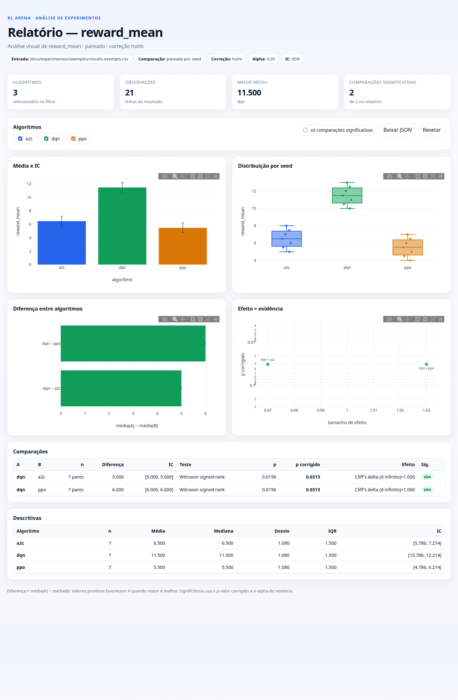

# Exemplo de relatório HTML

Arquivos **sintéticos** para visualizar a interface sem depender de um
experimento real:

- `results-exemplo.csv` — 3 algoritmos × 7 seeds.
- `report-exemplo.html` — gerado com:

```bash
python -m arenas.common.report \
  --input docs/experimentos/exemplos/results-exemplo.csv \
  --metric reward_mean --paired --baseline dqn \
  --out docs/experimentos/exemplos/report-exemplo.html
```

Abra o HTML no navegador. Ele mostra:

- médias com IC;
- distribuição por seed;
- diferenças `dqn − outro` com IC;
- efeito × p-valor corrigido;
- tabela ordenável e filtros.

Os números são inventados; o objetivo é só demonstrar a interface.


