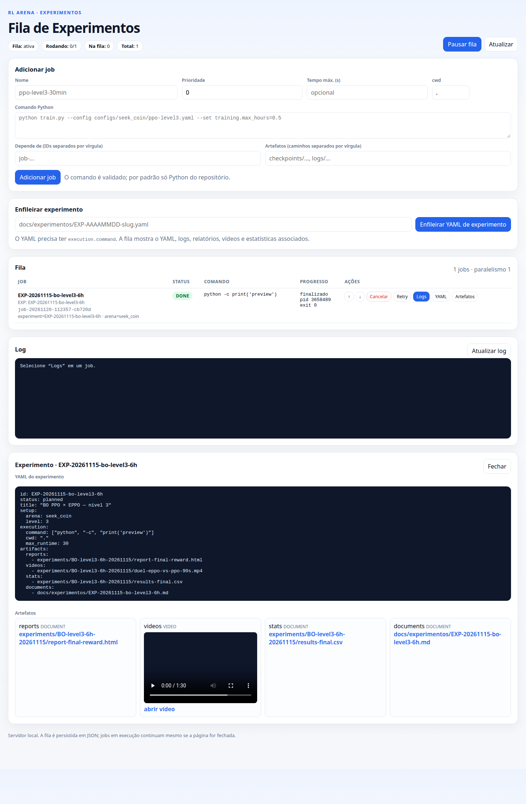
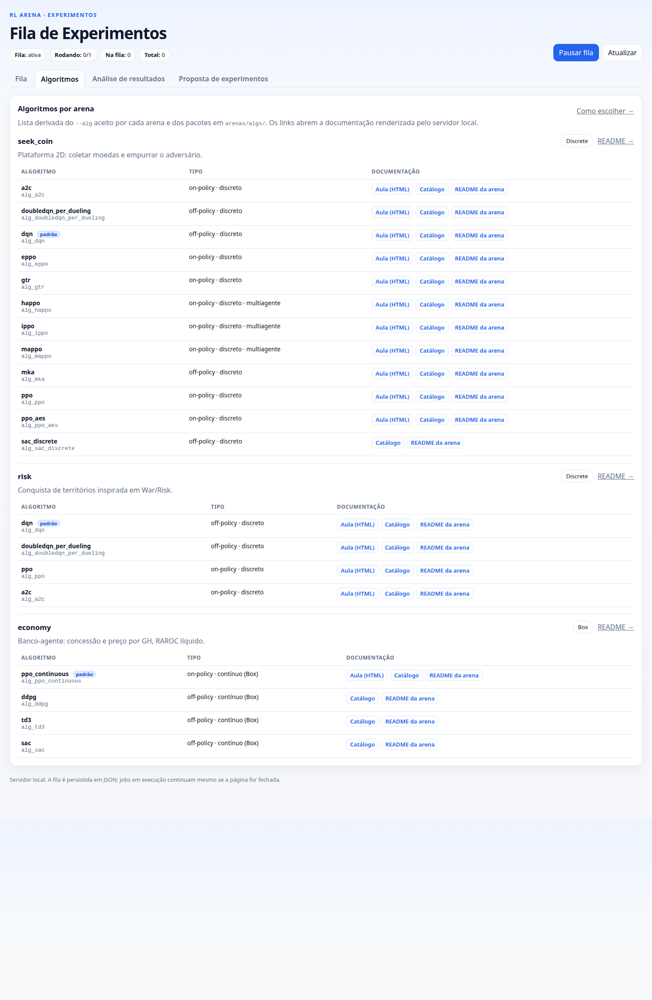
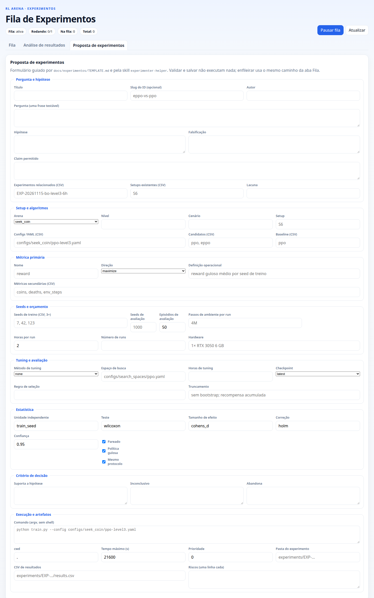

# Fila de Experimentos

Interface web local para acompanhar e administrar jobs de treino, BO,
validação e relatórios.



## Iniciar

```bash
python scripts/job_queue_server.py
```

Abra:

```text
http://127.0.0.1:8765/
```

Com um YAML de exemplo:

```bash
python scripts/job_queue_server.py \
  --load configs/queue-example.yaml \
  --state experiments/queue/queue.json
```

O estado da fila fica em `experiments/queue/queue.json` e os logs em
`experiments/queue/logs/`.

> A interface HTML é carregada na memória do processo. Depois de alterar
> `arenas/common/job_queue_ui.py`, reinicie o servidor para ver o novo layout.
> Recarregue o navegador com `Ctrl+Shift+R` se ainda houver cache.
>
> Se houver um experimento rodando, o reinício do servidor **não interrompe**
> os jobs, mas para conferir o layout novo sem mexer na instância atual suba
> uma segunda com estado e porta próprios:
>
> ```bash
> python scripts/job_queue_server.py \
>   --state /tmp/fila-preview/queue.json --port 8877
> ```

## O que a interface faz

- Separa a operação em quatro abas: **Fila**, **Algoritmos**,
  **Análise de resultados** e **Proposta de experimentos**.
- Lista experimentos/jobs com status, comando, PID, exit code, tempo e erro.
- Pausa/retoma a fila (jobs em execução continuam).
- Adiciona jobs por formulário.
- Enfileira um **YAML de experimento** pelo formulário ou pela CLI.
- Abre o **YAML do experimento** dentro da interface.
- Lista **artefatos** do experimento: logs, relatórios, vídeos, estatísticas,
  CSVs, imagens e documentos.
- Cancela, retenta e muda prioridade de jobs.
- Mostra o log do job selecionado, atualizado automaticamente.
- Persiste a fila entre reinícios do servidor.
- Respeita dependências e limite de jobs simultâneos.

## Submeter um experimento novo

### A partir do YAML do experimento

O fluxo recomendado é produzir o par `EXP-....md` + `EXP-....yaml` (skill
`experimenter-helper`) e enfileirar o YAML:

```bash
python scripts/experiment.py \
  --experiment docs/experimentos/EXP-20261117-sac-vs-ppo-economy.yaml
```

O YAML precisa ter:

```yaml
execution:
  command: ["python", "train.py", "--config", "configs/..." ]
  cwd: "."
  max_runtime: 21600
```

Também é possível enfileirar pela própria interface, no formulário
**Enfileirar experimento**, ou via API:

```bash
curl -X POST http://127.0.0.1:8765/api/experiments \
  -H 'Content-Type: application/json' \
  -d '{"path": "docs/experimentos/EXP-20261117-sac-vs-ppo-economy.yaml"}'
```

### A partir de um comando

Use o wrapper `scripts/experiment.py`. Ele adiciona o job à fila e inicia o
servidor automaticamente se ele ainda não estiver no ar:

```bash
python scripts/experiment.py --name ppo-30min \
  -- python train.py --config configs/seek_coin/ppo-level3.yaml \
  --set training.max_hours=0.5

python scripts/experiment.py --name bo-piloto --max-runtime 3600 \
  -- python scripts/bo_campaign.py --algorithms ppo,eppo \
  --hours-per-alg 0.1 --trial-minutes 2 --max-trials 2 \
  --out experiments/BO-piloto
```

Para carregar vários jobs de uma fila YAML:

```bash
python scripts/experiment.py --yaml configs/queue-example.yaml
```

Para esperar terminar e ver o status final:

```bash
python scripts/experiment.py --wait --timeout 3600 --name smoke \
  -- python train.py --episodes 1
```

O comando aceita `train.py`, `scripts/foo.py` ou `python ...`; o wrapper usa o
interpretador do ambiente atual.

## YAML e artefatos do experimento

Na linha do job, os botões **YAML**, **Artefatos** e **Logs** abrem o painel
do experimento. O botão YAML mostra o conteúdo de
`docs/experimentos/EXP-....yaml`; o botão Artefatos lista os caminhos
registrados no próprio YAML e no job.

Categorias reconhecidas:

| Artefato | Exemplo | Como aparece |
| --- | --- | --- |
| Log | `experiments/.../train.log` | link de texto |
| Relatório | `experiments/.../report.html` | link para abrir |
| Estatísticas | `results.csv`, `stats.csv` | link de CSV |
| Vídeo | `duel.mp4` | player embutido |
| Imagem | `preview.png` | imagem embutida |
| Documento | `README.md`, `protocol.md` | link |

Os caminhos são relativos à raiz do repositório. Arquivos fora do repositório
são recusados. O endpoint de arquivos suporta `Range`, então vídeos podem ser
reproduzidos no navegador.

## Status efetivo e sincronização do YAML

A interface combina o status do **job** com o `status` declarado no YAML:

| Status do job | Status efetivo no YAML |
| --- | --- |
| `queued` | `planned` |
| `running` | `running` |
| `done` | `done` |
| `failed` | `aborted` |
| `canceled` | `aborted` |

O painel do experimento mostra:

```text
YAML: planned · efetivo: done (divergente)
```

Quando há divergência, aparece o botão **Atualizar status do YAML**. Ele é
uma ação explícita: a fila não edita o arquivo sozinha. A atualização troca
apenas a linha `status:` do topo, preservando comentários e a ordem das
outras chaves, e grava de forma atômica.

Endpoints úteis:

```text
GET  /api/jobs/<id>/experiment         # YAML bruto
GET  /api/jobs/<id>/artifacts          # lista categorizada
GET  /api/jobs/<id>/results            # CSVs/JSONL de resultado + colunas
POST /api/jobs/<id>/analysis           # relatório estatístico do job
POST /api/analysis                     # relatório por caminho manual
POST /api/jobs/<id>/experiment/status  # grava o status efetivo no YAML
GET  /api/files?path=<rel>             # serve o arquivo (somente dentro do repo)
```

## Abas de algoritmos, análise, BO e proposta

As abas separam operação, referência, análise e proposta para não misturar o
que já rodou com o que ainda vai rodar. O deep link `?job=<id>` continua
abrindo o painel do experimento na aba **Fila**; `?tab=algorithms`,
`?tab=analysis`, `?tab=bo` e `?tab=proposal` abrem as abas novas. O botão
**Ver BO** no painel do experimento leva direto à campanha daquele job.

### Algoritmos



Lista os algoritmos de treino aceitos por `--alg` em cada arena:

| Arena | Fonte da lista |
| --- | --- |
| `seek_coin` | todos os pacotes não contínuos de `arenas/algs/` (inclui IPPO/MAPPO/HAPPO) |
| `risk` | `ArenaSpec.algorithms` (DQN, Double DQN, PPO, A2C) |
| `economy` | `ArenaSpec.algorithms` (PPO contínuo, DDPG, TD3, SAC) |

Cada linha mostra tipo (on/off-policy, discreto/contínuo, multiagente) e
links para a documentação existente no repositório: a aula HTML do
algoritmo, o catálogo de [`docs/algoritmos.md`](algoritmos.md) e o README da
arena. O backend é
[`arenas/common/algorithm_catalog.py`](../arenas/common/algorithm_catalog.py);
a lista vem de [`arenas/registry.py`](../arenas/registry.py), então um
`alg_*` novo aparece sozinho no seek_coin e as arenas com lista explícita
continuam iguais ao `--alg`.

Os links abrem `/docs/<caminho-do-repo>`: o servidor renderiza Markdown
(`markdown` com tabelas, blocos de código e âncoras) e serve HTML/CSS/JS das
aulas, sempre restrito à raiz do repositório.

### Análise de resultados

Escolha um job/experimento e um arquivo de resultado (ou informe um caminho
manual), depois a métrica, a unidade independente, o baseline, a correção
múltipla e se a análise deve agregar por unidade (`--aggregate`). Os
artefatos do experimento (relatórios MD/HTML, CSVs, vídeos e imagens) também
aparecem na aba para consulta direta.

A estatística não é reimplementada: o backend usa
[`arenas/common/report.py`](../arenas/common/report.py) e o HTML interativo de
[`arenas/common/report_html.py`](../arenas/common/report_html.py). A tela
mostra descritivas, IC, teste, tamanho de efeito, p corrigido e avisos; o
relatório completo (gráficos de médias/IC, distribuição por seed, diferença
A−B e efeito × p ajustado) aparece embutido e pode ser aberto em nova aba.

A interface explicita a unidade independente:

- **análise primária** — uma linha por `train_seed`, `seed`, `run_id` ou
  `trial`;
- **análise secundária** — uma linha por `episode`, `episode_seed` ou
  `eval_seed`; o relatório avisa sobre pseudo-replicação, porque episódios da
  mesma run não são runs independentes.

Arquivos precisam estar dentro do repositório. A aba aceita filtros
`campo=valor` e não executa comandos.

### BO

A aba **BO** lê as campanhas de `scripts/bo_campaign.py` e
`scripts/asha_campaign.py` direto dos diretórios que elas já gravam — não
recalcula treino nem inventa trials:

```text
experiments/<campanha>/
  campaign.json          # manifesto (algoritmos, espaço, config base)
  ppo/
    trials.jsonl         # um trial por linha (BO ou ASHA)
    best.json            # melhor trial, validação final
    results.csv          # ASHA (opcional)
  eppo/ ...
```

Escolha um job (o botão **Ver BO** do painel do experimento) ou informe o
caminho da campanha. A tela mostra:

- **convergência**: score por trial, melhor score acumulado (best-so-far),
  marcação do trial escolhido (★) e da validação final (◆), com um algoritmo
  por cor;
- **efeito de cada parâmetro**: dispersão parâmetro × score, média por faixa
  com IC de 95%, correlação de Spearman (numéricos) e box/strip com η²
  (categóricos, usando o tipo declarado no espaço de busca);
- **importância**: ranking por |Spearman| ou η²;
- **melhoria**: best-so-far contra a mediana e o primeiro trial válido, com
  os parâmetros do melhor trial comparados à config base;
- **interação**: heatmap de média/contagem para os dois parâmetros numéricos
  mais importantes;
- **parallel coordinates** dos trials válidos;
- **tabela de trials**: índice, status, score, reward, moedas, mortes,
  duração, parâmetros, log/artefato e erro — ordenável e filtrável por status.

Tudo é **exploratório**: a aba avisa quando há menos de 10 trials válidos,
lista falhos e outliers e não afirma causalidade. Filtros (algoritmo,
parâmetro e status) ficam na URL (`?tab=bo&bo=...&alg=...&param=...&status=...`)
e os trials filtrados podem ser exportados em CSV/JSON. Os gráficos usam o
mesmo Plotly do relatório estatístico (CDN).

Backend: [`arenas/common/bo_analysis.py`](../arenas/common/bo_analysis.py)
normaliza trials de BO e ASHA (inclusive `results.csv`), valida todos os
caminhos dentro do repositório e devolve as séries/estatísticas prontas.

### Proposta de experimentos



O formulário segue [`docs/experimentos/TEMPLATE.md`](experimentos/TEMPLATE.md)
e a skill `experimenter-helper`:

1. **Prévia MD + YAML** monta os dois arquivos sem gravar e lista os erros de
   validação.
2. **Salvar** grava `docs/experimentos/EXP-AAAAMMDD-slug.{md,yaml}` e recusa
   sobrescrever, a menos que **Sobrescrever** esteja marcado.
3. **Salvar e enfileirar** grava e cria o job com `execution.command`.

A validação é compartilhada com o script da skill
([`validate_yaml.py`](../.agents/skills/experimenter-helper/scripts/validate_yaml.py)),
que delega para
[`arenas/common/experiment_proposal.py`](../arenas/common/experiment_proposal.py).
Ela exige pergunta, hipótese, falsificação, 3+ seeds, baseline, métrica
primária, orçamento, protocolo de avaliação, critérios de decisão e um
`execution.command` que comece por Python e aponte para dentro do repositório.
Nenhum comando passa por shell.

Endpoints novos:

```text
GET  /api/algorithms          # catálogo por arena + links de docs
GET  /docs/<caminho-do-repo>  # Markdown renderizado ou arquivo de docs
GET  /api/jobs/<id>/results   # arquivos, métricas, seeds e algoritmos
GET  /api/bo?path=<rel>       # campanha BO/ASHA normalizada
GET  /api/jobs/<id>/bo        # campanha do job (artefatos/--out/cwd)
POST /api/jobs/<id>/analysis  # relatório de um job
POST /api/analysis            # relatório de um caminho manual
POST /api/proposals/preview   # MD + YAML + erros (sem gravar)
POST /api/proposals/validate  # valida `fields` ou `yaml`
POST /api/proposals/save      # grava sem sobrescrever (409 se existir)
POST /api/proposals/enqueue   # grava e enfileira
```

## Treino local esperando permissão

`python train.py ...` continua rodando **no processo local**, mas antes ele
registra o próprio PID como um job `local` na fila e espera a vez:

```bash
python train.py --arena seek_coin --alg ppo --config configs/seek_coin/ppo-level3.yaml
```

Se a fila não estiver no ar, ela é iniciada automaticamente. O job aparece na
UI como `local` e só passa para `running` quando há slot disponível. Ao
terminar, o próprio `train.py` marca o job como `done`/`failed`.

O `stdout`/`stderr` do processo local é duplicado para
`experiments/queue/logs/<job-id>.log`; o botão **Logs** da UI mostra esse
arquivo. Jobs iniciados antes dessa correção não têm log retroativo.

Para ignorar a fila numa execução específica:

```bash
python train.py --no-queue --episodes 10
# ou
RL_ARENA_QUEUE_BYPASS=1 python train.py --episodes 10
```

Jobs iniciados **pelo servidor** recebem `RL_ARENA_QUEUE_BYPASS=1`
automaticamente, então não há deadlock: o servidor inicia o `train.py`, que
não tenta entrar na fila de novo.

Variáveis úteis:

```bash
RL_ARENA_QUEUE_URL=http://127.0.0.1:8765
RL_ARENA_QUEUE_STATE=experiments/queue/queue.json
```

## Formato YAML

```yaml
jobs:
  - name: ppo-level3-15min
    command: >-
      python train.py --config configs/seek_coin/ppo-level3.yaml
      --set training.max_hours=0.25
      --set training.checkpoint_dir=experiments/queue-runs/ppo
    cwd: .
    priority: 10
    max_runtime: 1200
    tags:
      arena: seek_coin
      alg: ppo
    artifacts:
      - experiments/queue-runs/ppo
```

- `command` é argv (string é separada com `shlex`) e **não passa por shell**.
- `depends_on` usa nomes ou IDs de jobs anteriores.
- `max_runtime` é em segundos; jobs que excedem são cancelados.
- `priority` maior roda antes.
- `artifacts` são caminhos mostrados/associados ao job.

## API

```bash
curl http://127.0.0.1:8765/api/state
curl -X POST http://127.0.0.1:8765/api/queue/pause
curl -X POST http://127.0.0.1:8765/api/queue/resume
curl http://127.0.0.1:8765/api/jobs/<id>/log?lines=100
```

Adicionar job:

```bash
curl -X POST http://127.0.0.1:8765/api/jobs \
  -H 'Content-Type: application/json' \
  -d '{
    "name": "ppo-30min",
    "command": "python train.py --config configs/seek_coin/ppo-level3.yaml --set training.max_hours=0.5",
    "cwd": ".",
    "priority": 5,
    "max_runtime": 2400
  }'
```

Carregar YAML:

```bash
curl -X POST http://127.0.0.1:8765/api/load \
  -H 'Content-Type: application/json' \
  -d '{"path": "configs/queue-example.yaml"}'
```

## Segurança

- O bind padrão é `127.0.0.1`; não exponha o servidor sem autenticação.
- Por padrão só comandos Python do repositório são aceitos.
- `--allow-arbitrary` desliga essa validação; use apenas localmente.
- O servidor não usa shell (`shell=False`).

## Robustez

- Se o servidor reiniciar, jobs com PID inexistente são marcados como
  `failed`; jobs em execução com PID vivo continuam listados.
- `cancel` envia SIGTERM ao grupo do processo e depois SIGKILL se necessário.
- `retry` reenfileira jobs `failed`/`canceled`/`done`, mantendo o histórico de
  tentativas.

## Testes

```bash
pytest -q arenas/common/tests/test_job_queue.py \
         arenas/common/tests/test_queue_workbench_api.py \
         arenas/common/tests/test_algorithm_catalog.py \
         arenas/common/tests/test_experiment_analysis.py \
         arenas/common/tests/test_experiment_proposal.py
```

- `test_job_queue.py` — scheduler, dependências, persistência e status.
- `test_queue_workbench_api.py` — endpoints de algoritmos/docs, resultados,
  análise e propostas.
- `test_algorithm_catalog.py` — lista por arena, metadados e links de docs.
- `test_experiment_analysis.py` — descoberta de arquivos, unidade
  primária/secundária, métrica/baseline, `--aggregate` e recusa de caminhos
  fora do repositório.
- `test_experiment_proposal.py` — geração MD+YAML, validação, recusa de
  sobrescrita e delegação da skill.
